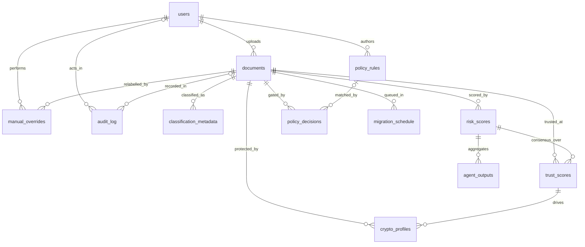

# Data dictionary

The authoritative, column-level definition of the relational schema described in
`SPEC.md` Section 5. This file is the source of truth. When a column changes, it
changes here in the same pull request that changes the SQLAlchemy model and the
Alembic migration, per `AGENTS.md`. If this file and the code disagree, that is a
defect, not a documentation lag.

Implemented by `backend/app/db/models/` and created by
`backend/alembic/versions/`. Neo4j (`SPEC.md` 3.11) and the vector store
(`SPEC.md` 3.12) are deliberately outside this schema; see the reasoning at the
end.

## Provenance

The schema originates in the team's CIA-I System Design Component submission
(10 August 2026), Section 4, which held the original entity-relationship diagram
and data dictionary. That document is coursework and lives outside this
repository, so it is not linkable from here and cannot be updated alongside a
migration. This file was written from it and replaces it as the cited reference.
Where the two differ, this file wins, and every deliberate difference is listed
under "Deviations from the CIA-I design" below with its reason.

## Conventions

- **Primary keys** are `uuid`, generated server-side, never client-supplied.
  Sequential integers were rejected because several modules write concurrently
  and because a sequential id leaks the total document count to anyone holding a
  single id.
- **Timestamps** are `timestamptz`, never naive `timestamp`.
- **Every foreign key is indexed.** Nearly every real query is "get everything
  for document X".
- **Enums** are native Postgres enum types, named in each table below. A new
  value is added by migration, not by writing an unconstrained string.
- **`jsonb` appears in exactly three places**: `risk_scores.context_snapshot`,
  `policy_rules.condition_expr`, and `audit_log.payload`. Each needs to gain new
  fields over time without a migration. The rest of the schema is strongly typed
  on purpose; `jsonb` everywhere would be easier to write and much harder to
  query or trust.

## Append-only tables

`classification_metadata`, `risk_scores`, `trust_scores`, and `crypto_profiles`
are history tables. A document is reclassified, re-scored, and re-protected over
its lifetime, and the audit log only means anything if past decisions are never
silently overwritten. A new decision is a new row that supersedes the previous
one; it never updates it.

`audit_log` is stricter still: append-only against both UPDATE and DELETE.

Enforcement is at the database level, not by application convention
(`SPEC.md` 3.8, `PRD.md` FR-7):

| Table | UPDATE | DELETE | TRUNCATE |
|---|---|---|---|
| `audit_log` | rejected by trigger | rejected by trigger | rejected by trigger |
| `classification_metadata` | rejected by trigger | permitted | permitted |
| `risk_scores` | rejected by trigger | permitted | permitted |
| `trust_scores` | rejected by trigger | permitted | permitted |
| `crypto_profiles` | rejected by trigger | permitted | permitted |

The four history tables block UPDATE only, which is precisely what "never
updated in place" requires, and no more. DELETE is left permitted there
deliberately: erasure (`PRD.md` FR-8) works by destroying a document's key rather
than its rows, so nothing in the design needs to delete them, but a blanket
prohibition with no requirement behind it invites someone to disable the trigger
later for an unrelated reason. `audit_log` is different, FR-7 states the
guarantee absolutely, so it is enforced absolutely.

The `TRUNCATE` row is not redundant. `TRUNCATE` does not fire row-level
triggers, so a row-level guard alone leaves the whole table erasable in one
statement. `audit_log` therefore also carries a statement-level `BEFORE TRUNCATE`
trigger.

Honest limit: a superuser can drop a trigger. This stops every application code
path and every accidental migration, which is what it is for. It is not a
defense against a database superuser, and nothing here should be described as
though it were.

---

## Relationships

`users` and `documents` are the roots. `documents` has a one-to-many to
`classification_metadata`, `manual_overrides`, `risk_scores`, `trust_scores`,
`policy_decisions`, `crypto_profiles`, `migration_schedule`, and `audit_log`.
`risk_scores` has a one-to-many to `agent_outputs`, with five rows expected per
risk score, one per agent type. `trust_scores` has a one-to-many to
`crypto_profiles`, since a profile records which trust score drove it.
`policy_rules` has a one-to-many to `policy_decisions`. Every foreign key to
`users` or `documents` is `uuid`.

Drawn as Mermaid rather than as a checked-in `.svg` so it renders on GitHub and
changes in a reviewable diff alongside the migration that changes it. A binary
diagram would go stale silently, which is the same failure that left the schema
citation unopenable in the first place. `o|` on a relationship marks the optional
side, so the two nullable foreign keys are visible here and not only in the
tables below.

The four append-only history tables are `classification_metadata`,
`risk_scores`, `trust_scores`, and `crypto_profiles`. Reading the diagram along
`documents`, each of those is a growing list rather than a single current row,
which is why none of them carries a "current" flag.

---

## `users`

| Column | Type | Null | Notes |
|---|---|---|---|
| `id` | `uuid` PK | no | Generated server-side, never client-supplied |
| `name` | `varchar(120)` | no | |
| `email` | `varchar(255)` unique | no | Login identity |
| `role` | `user_role` | no | `data_owner`, `security_analyst`, `security_admin`, `compliance_officer`, `auditor`, `ciso`, `engineer` |
| `created_at` | `timestamptz` | no | Defaults to `now()` |

## `documents`

| Column | Type | Null | Notes |
|---|---|---|---|
| `id` | `uuid` PK | no | |
| `uploaded_by` | `uuid` FK → `users.id` | no | `ON DELETE RESTRICT`; a document's owner cannot be deleted out from under it |
| `filename` | `varchar(255)` | no | Original filename, not the storage key |
| `storage_path` | `varchar(500)` | yes | Object storage key. Null until a file is actually stored; see `registered` below |
| `uploaded_at` | `timestamptz` | no | Defaults to `now()` |
| `current_status` | `document_status` | no | `registered`, `uploaded`, `classified`, `protected`, `archived` |

`current_status` is the one mutable status field in the schema. It is a pointer
to the current lifecycle stage, not a decision record; every decision that moves
it is preserved in its own history table and in `audit_log`.

## `classification_metadata`

Append-only. One row per classification run.

| Column | Type | Null | Notes |
|---|---|---|---|
| `id` | `uuid` PK | no | |
| `document_id` | `uuid` FK → `documents.id` | no | Indexed |
| `sensitivity_label` | `sensitivity_label` | no | `PUBLIC`, `INTERNAL`, `CONFIDENTIAL`, `RESTRICTED`. The label acted on, after fail-safe escalation |
| `confidence_score` | `numeric(5,4)` | no | `0.0000` to `1.0000`, `CHECK` enforced. Confidence in the pre-escalation judgement |
| `model_version` | `varchar(30)` | no | For example `stub-keyword-rules-0.1.0` |
| `is_defaulted` | `boolean` | no | True when confidence fell below the threshold and the fail-safe applied |
| `classified_at` | `timestamptz` | no | Indexed, defaults to `now()` |

The classifier also produces a pre-escalation `base_label`, the threshold in
force, the keywords that fired, and a rationale. Those are not columns here: the
first two are derivable and the last two are artifacts of the current keyword
stub, which `SPEC.md` 3.2 says is replaced by a trained model. They are preserved
in full in the corresponding `audit_log.payload`, so no explainability is lost
and the typed table does not accumulate columns tied to an implementation that is
scheduled to be thrown away.

## `manual_overrides`

| Column | Type | Null | Notes |
|---|---|---|---|
| `id` | `uuid` PK | no | |
| `document_id` | `uuid` FK → `documents.id` | no | Indexed |
| `overridden_by` | `uuid` FK → `users.id` | no | Indexed |
| `original_label` | `sensitivity_label` | no | Snapshot of the label before the override |
| `new_label` | `sensitivity_label` | no | `CHECK` enforces it differs from `original_label` |
| `justification` | `text` | no | `CHECK` enforces at least 20 characters (`PRD.md` FR-12) |
| `overridden_at` | `timestamptz` | no | Defaults to `now()` |

FR-12's 20-character minimum is enforced in the database as well as the API. It
is an acceptance criterion, not a UI nicety, and a row that violates it should
not be storable by any path.

## `risk_scores`

Append-only. One row per recomputation.

| Column | Type | Null | Notes |
|---|---|---|---|
| `id` | `uuid` PK | no | |
| `document_id` | `uuid` FK → `documents.id` | no | Indexed |
| `risk_value` | `numeric(4,3)` | no | `0.000` to `1.000`, `CHECK` enforced. Aggregate across `agent_outputs` |
| `context_snapshot` | `jsonb` | no | User, device, network, and behaviour signals as they were at computation time |
| `computed_at` | `timestamptz` | no | Indexed; dashboard queries filter by recency |

## `agent_outputs`

| Column | Type | Null | Notes |
|---|---|---|---|
| `id` | `uuid` PK | no | |
| `risk_score_id` | `uuid` FK → `risk_scores.id` | no | Indexed. Five rows expected per `risk_scores` row |
| `agent_type` | `agent_type` | no | `security`, `compliance`, `contextual`, `quantum`, `sustainability` |
| `score` | `numeric(4,3)` | no | `0.000` to `1.000`, `CHECK` enforced |
| `rationale` | `text` | no | Human-readable, surfaced in the summary report (`PRD.md` FR-16) |

Unique on `(risk_score_id, agent_type)`: one output per agent per assessment. A
duplicate means an agent ran twice and the consensus function would double-count
it.

A separate child table rather than five nullable columns on `risk_scores`, so a
sixth agent type needs no migration and the one-to-five relationship is
structural rather than conventional.

## `trust_scores`

Append-only. One row per recomputation. The Trust Engine's output
(`SPEC.md` 3.5).

| Column | Type | Null | Notes |
|---|---|---|---|
| `id` | `uuid` PK | no | |
| `document_id` | `uuid` FK → `documents.id` | no | Indexed |
| `risk_score_id` | `uuid` FK → `risk_scores.id` | no | Indexed. The assessment whose `agent_outputs` produced this score |
| `consensus_value` | `numeric(4,3)` | no | `0.000` to `1.000`, `CHECK` enforced |
| `consensus_version` | `varchar(30)` | no | Version of the consensus function that produced this value |
| `computed_at` | `timestamptz` | no | Indexed, defaults to `now()` |

## `policy_rules`

| Column | Type | Null | Notes |
|---|---|---|---|
| `id` | `uuid` PK | no | |
| `rule_name` | `varchar(150)` unique | no | |
| `condition_expr` | `jsonb` | no | Serialised condition tree from the rule builder (`PRD.md` FR-13) |
| `action` | `policy_action` | no | `allow`, `deny`, `require_mfa`, `force_pqc` |
| `priority` | `int` | no | `CHECK` enforces a positive integer. Lower value is evaluated first |
| `active` | `boolean` | no | Defaults true |
| `created_by` | `uuid` FK → `users.id` | no | Indexed |
| `created_at` | `timestamptz` | no | Defaults to `now()` |

Unique partial index on `priority` where `active` is true: two active rules
cannot share a priority. Without it, evaluation order between equal-priority
rules is undefined, which for a module that gates security decisions means the
outcome depends on the query plan.

## `policy_decisions`

| Column | Type | Null | Notes |
|---|---|---|---|
| `id` | `uuid` PK | no | |
| `document_id` | `uuid` FK → `documents.id` | no | Indexed |
| `rule_id` | `uuid` FK → `policy_rules.id` | **yes** | Null when no rule fired and the AI recommendation stood |
| `ai_recommendation` | `policy_action` | no | What the AI proposed before the gate |
| `final_decision` | `policy_action` | no | What the system acted on |
| `overridden` | `boolean` | no | True when `final_decision` differs from `ai_recommendation` |
| `decided_at` | `timestamptz` | no | Defaults to `now()` |

`rule_id` is nullable because "no rule fired, the AI recommendation stood" is the
common outcome (`SPEC.md` 3.6, `PRD.md` FR-5). A placeholder no-op rule row
invented to satisfy a `NOT NULL` is explicitly not the design.

`CHECK (overridden = (final_decision IS DISTINCT FROM ai_recommendation))` keeps
the flag from drifting away from the two columns it summarises.

## `crypto_profiles`

Append-only. One row per selection or reselection.

| Column | Type | Null | Notes |
|---|---|---|---|
| `id` | `uuid` PK | no | |
| `document_id` | `uuid` FK → `documents.id` | no | Indexed |
| `trust_score_id` | `uuid` FK → `trust_scores.id` | no | Indexed. The specific trust score that drove this choice (`PRD.md` FR-6) |
| `profile_type` | `crypto_profile_type` | no | `aes256`, `hybrid`, `post_quantum` |
| `selected_at` | `timestamptz` | no | Indexed, defaults to `now()` |

Parameter sets behind each profile are in `SPEC.md` Section 6 and are not
duplicated here. `hybrid` means `X25519MLKEM768`; `post_quantum` means ML-KEM-1024
with ML-DSA-87.

## `migration_schedule`

| Column | Type | Null | Notes |
|---|---|---|---|
| `id` | `uuid` PK | no | |
| `document_id` | `uuid` FK → `documents.id` | no | Indexed |
| `priority_rank` | `int` | no | `CHECK` enforces positive. Scheduler output (`SPEC.md` 3.10) |
| `scheduled_upgrade_date` | `date` | yes | Null until scheduled |
| `status` | `migration_status` | no | `pending`, `in_progress`, `done` |
| `constraint_snapshot` | `jsonb` | no | The constraint values that produced this rank (`PRD.md` FR-9 requires ranking output to include them, not just the order) |

## `audit_log`

Append-only against UPDATE, DELETE, and TRUNCATE. Every decision anywhere in the
pipeline writes exactly one row here (`PRD.md` FR-7).

| Column | Type | Null | Notes |
|---|---|---|---|
| `id` | `uuid` PK | no | |
| `document_id` | `uuid` FK → `documents.id` | **yes** | Null for events with no document, for example a policy rule being created |
| `actor_id` | `uuid` FK → `users.id` | **yes** | The acting user. Null for events raised by a system module with no human actor |
| `event_type` | `varchar(60)` | no | For example `document_registered`, `classification_completed`, `manual_override`, `crypto_profile_selected` |
| `payload` | `jsonb` | no | The canonical event body that `payload_hash` is the hash of |
| `payload_hash` | `char(64)` | no | SHA-256 of the canonical serialisation of `payload` |
| `prev_hash` | `char(64)` | **yes** | `payload_hash` of the preceding row in the same chain. Null on the genesis entry, which by definition has no predecessor |
| `merkle_root_at_time` | `char(64)` | no | Merkle root over the chain as of this row |
| `created_at` | `timestamptz` | no | Indexed, defaults to `now()` |

**Chains are per document.** `prev_hash` refers to the previous entry for the
same `document_id`; rows with a null `document_id` form one separate system
chain. Verification and the audit viewer (`PRD.md` FR-15) both operate on one
document's chain, and a single global chain would serialise every write in the
system behind one row.

**Forks are structurally impossible.** Unique on `(document_id, prev_hash)` with
`NULLS NOT DISTINCT`. Two rows claiming the same predecessor is exactly what a
fork is, so the constraint rejects it, and `NULLS NOT DISTINCT` extends that to
the genesis entry so a chain cannot have two beginnings. Writers additionally
take a transaction-scoped advisory lock per chain, so concurrent appends queue
instead of one failing on the constraint; the constraint is the guarantee, the
lock is the courtesy.

**`payload` exists so verification is real.** The CIA-I dictionary stored only
`payload_hash`. That is enough to check that hashes agree with each other, but
`SPEC.md` 3.8 and `PRD.md` FR-7 require an auditor who does not trust this system
to confirm that each hash matches the actual event data, which is impossible if
the data was never stored. `backend/app/audit/merkle.py`'s `canonicalize()`
already expects the payload mapping.

Honest limit on the chain itself: `prev_hash` links rows but is not itself
covered by `payload_hash`, so an attacker with write access could recompute a
whole consistent chain. `merkle_root_at_time` and external anchoring of the root
are what make that detectable; the chain alone is not sufficient and should not
be described as if it were.

---

## Deviations from the CIA-I design

Each of these differs from the CIA-I Section 4 dictionary on purpose.

1. **`audit_log.payload` added.** Independent re-verification is impossible
   without the payload. See above. Logged in `docs/decisions.md`.
2. **`audit_log.actor_id` added.** CIA-I's Output Screen 2 has an "Actor" column
   sourced from "the acting user", but the table had no column holding one, so
   the screen could not have been built as specified.
3. **`audit_log.prev_hash` is nullable.** CIA-I types it `char(64)` throughout
   while naming a genesis entry, which cannot have a predecessor. A sentinel of
   64 zeros was rejected: it is indistinguishable from a real hash and invites
   verification code that treats a forged all-zero value as "this is the start".
4. **`sensitivity_label` values are uppercase**, not CIA-I's lowercase. The
   shipped `SensitivityLabel` enum in `backend/app/classifier/labels.py` uses
   `PUBLIC` and already serialises that way in the live `/classify` response.
   Matching it keeps exactly one representation across the API and the database
   instead of a mapping layer between them. That module belongs to the classifier
   owner (`WORK_DIVISION.md`), so the alternative would have meant editing
   another owner's module and its tests to satisfy a casing preference. If
   lowercase is preferred, it changes in `labels.py` and in the enum here in the
   same pull request.
5. **`confidence_score` is `numeric(5,4)`**, not `numeric(4,3)`. The classifier
   rounds confidence to four decimal places, so three would silently store a
   different number than the API returned for the same classification.
6. **`document_status` gains `registered`.** A document whose metadata exists but
   whose file has not been stored is not `uploaded`, and labelling it so would put
   a false statement in the lifecycle field. `storage_path` is nullable for the
   same reason.
7. **`trust_scores.risk_score_id` and `consensus_version` added.** FR-4 requires
   every trust score to reference the exact agent outputs that produced it and
   the consensus function to be versioned. Neither was representable.
8. **`migration_schedule.constraint_snapshot` added.** FR-9 requires ranking
   output to include the constraint values used, not just the resulting order.
9. **`agent_outputs` unique on `(risk_score_id, agent_type)`**, and
   **`policy_rules` unique on active `priority`.** The second closes DEF-10 from
   the team's Sprint 3 defect log, which recorded equal-priority evaluation order
   as undefined, at the schema level rather than in the rule builder UI.
10. **`policy_decisions.ai_recommendation` and `final_decision` use
    `policy_action`.** CIA-I says "enum" for both without listing values. Sprint 3
    describes a matching rule's `action` becoming the `final_decision`, so all
    three share one domain.

## Why Neo4j and the vector store are not here

Forcing a multi-hop attack-path query or a similarity search into relational
tables would work and would misrepresent how either is actually queried. Both
reference `documents.id` conceptually, but as an application-level link, not a
database-enforced foreign key. Polyglot persistence means giving up that
guarantee deliberately in exchange for the right query model per problem.
